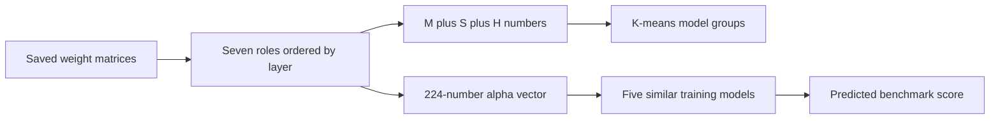

# Spectral Model Lineage And Performance Prediction

## What This Study Does

A language model contains many large tables of numbers called weight matrices.
Training and fine-tuning change these matrices. We analyze their squared singular
values to answer two separate questions:

1. **Lineage discovery:** which models likely belong to the same broad base-model
   family?
2. **Performance prediction:** can we estimate benchmark scores without running
   the benchmarks again?

These are statistical predictions. They do not prove that one model was created
from another.

## What We Measure

For a weight matrix `W`, the squared singular values are the eigenvalues of
`W^T W`. They describe how strongly the matrix acts in different directions.

Heavy-Tailed Self-Regularization (HTSR) fits a power law to the largest of these
values. Its exponent is called `alpha`. We also use matrix size, weight scale,
spectral norm, entropy, and stable rank.

We collect these values for seven matrix roles in each transformer layer:

- attention query, key, value, and output;
- feed-forward gate, up projection, and down projection.

The order through the layers matters. Two models can have the same average alpha
but different sequences from the first layer to the last.

## The Large-Scale Data

The Phase 2 collection contains:

- **15,000** model records;
- **8,892** models with saved spectral measurements;
- **7,534** models passing the strict lineage rules;
- **8,284** models passing the less strict rules;
- **650** modern benchmark-labelled models usable for ancestry-separated alpha
  prediction; and
- **348** legacy benchmark-labelled models with known parent-child links.

Not every model can answer every question. Some have matrix measurements but no
benchmark score. Others have scores but no known ancestry.

## Lineage Discovery

### Method

Each model becomes one row of numbers:

- **M:** layer count, matrix dimensions, role coverage, and parameter count;
- **S:** weight scale, largest squared singular value, spectral entropy, and
  stable-rank ratio; and
- **H:** alpha, `alpha * log10(spectral norm)`, and
  `log10(sum(squared singular value^alpha))`.

For each role, we summarize every value by its median, middle 50% range, change
from early to late layers, and missing-value fraction.

The strict calculation then proceeds as follows:

1. Keep models with all seven roles, no row that combines roles, at least 80% of
   layers present for every role, and at least 80% of all M, S, and H values.
2. Replace remaining missing entries with the median of their column.
3. Subtract each column's mean and divide by its standard deviation.
4. Set the number of clusters to `ceiling(sqrt(number of models / 2))`, which is
   62 for the current data.
5. Run K-means without giving it family labels.
6. Compare the finished clusters with known families.

Known-family prediction is separate from clustering and uses only S. For each
query, remove that model from the known examples. In each family, choose the
actual model with the smallest root-mean-square difference from that family's
column medians. Rank these family examples by the query's distance to them. If
fewer than 80% of the values can be compared, return no family. The ranking score
`1 / (1 + distance)` is not a probability.

The less strict calculation only requires 80% of all M, S, and H values to be
present. It covers more models but does not enforce the seven-role and per-role
layer rules. Its extra clusters and family suggestions are for human review.

### Results

The strict calculation clustered **7,534 models**.

| Measure | Result | Plain meaning |
| --- | ---: | --- |
| Adjusted Rand index (ARI) | 0.850 | Models from the same known families were usually grouped together |
| Normalized mutual information (NMI) | 0.905 | Knowing a cluster gave strong information about the family |
| Matched-family recall | 0.847 | About 85% of each known family was recovered on average |

Known-family prediction reached approximately **96.9% first-choice accuracy** on
174 labelled queries from 11 families, after calculating accuracy within each
family and averaging the family results equally. This labelled set is much
smaller than the full collection.

Exact-parent first-choice accuracy was only **6.5%**. The measurements support
broad family grouping, not exact parent identification or a complete training
history.

The less strict clustering covers **8,284 models**. Its family suggestions remain
distance-based review candidates, not ancestry labels.

## Performance Prediction

### Main Method

The current predictor turns each model's per-layer alpha values into one vector:

1. Keep layer positions where all seven roles have a valid alpha.
2. Scale depth from 0 at the first retained layer to 1 at the last.
3. Estimate alpha at 32 evenly spaced positions for each role.
4. Replace each role's 32 values by their rank order, subtract the mean rank, and
   scale the resulting vector to length 1.
5. Join the seven role vectors into one vector of `7 * 32 = 224` numbers.
6. Find the five training models with the largest average dot product across the
   seven roles.
7. Predict the benchmark score by a weighted average of their scores, giving more
   weight to a more similar model.

Clustering is not an input to this predictor. Known ancestry is used to separate
training and test data: every connected parent-child group goes entirely to one
side. The five neighbours must also come from five different ancestry groups.
This prevents one large family from filling the neighbour list.

### Comparison Methods

We compare the alpha-vector predictor with Ridge regression, a linear model that
penalizes large coefficients. Ridge receives three increasing sets of inputs:

- **M:** model structure only;
- **M+S:** model structure and non-alpha spectral values; and
- **M+S+H:** all summary values, including alpha.

The missing-value replacement, column scaling, and Ridge penalty are learned only
from the training part of each split.

### Modern Benchmark Results

Every method is evaluated on the same 649 models from 139 ancestry groups.

| Method | Component-weighted MAE | Spearman rank correlation |
| --- | ---: | ---: |
| Model structure only | 3.711 | 0.666 |
| Structure and non-HTSR spectra | 3.562 | 0.726 |
| Structure, spectra, and HTSR summaries | 3.455 | 0.734 |
| **Direct alpha vector** | **3.082** | **0.767** |

Mean absolute error (MAE) is the average absolute difference between a prediction
and the real score. Here it is first calculated within each ancestry group, then
averaged so every group has equal weight. MAE 3.082 means an average error of
about 3.1 benchmark percentage points. Spearman correlation measures whether the
predicted and real score orderings agree; 1 means perfect agreement.

The direct alpha vector reduced MAE by **0.373 points** relative to M+S+H Ridge.
Resampling whole ancestry groups gave a 95% improvement interval of **0.037 to
0.727 points**. A paired random sign-flip test gave `p=0.037`: 3.7% of the
sign-flipped trials produced an absolute difference at least this large.

### Legacy Benchmark Results

| Method | Component-weighted MAE |
| --- | ---: |
| Structure, spectra, and HTSR summaries | 5.463 |
| **Direct alpha vector** | **4.135** |

Across 348 models from 122 ancestry groups, the direct alpha vector reduced the
six-task-average MAE by **1.328 points**. Its 95% improvement interval was
**0.554 to 2.104 points**, with `p=0.0013`. Five of the six tasks remained
improved after correcting for testing six tasks; Massive Multitask Language
Understanding (MMLU) was the exception.

## Why We Do Not Lead With The Lowest Error

A paper-like random split reached a lower modern MAE of 2.805 across 942 models.
However, nearly half of its test models had a known relative in training. It
mostly tests prediction when a related model is already available. The main
result instead keeps known relatives on the same side of the split.

## What Did Not Help

We tried predicting Ridge's remaining error from nearby alpha vectors. This
two-stage method did not reliably improve the modern result. A small follow-up
also found no useful gain from raw alpha values or vectors containing every saved
spectral measurement. Ranking alpha within each role remains the simplest method
with the lowest ancestry-separated error.

## Conclusion And Limits

- The matrix measurements work well for **broad model-family discovery**.
- They do not reliably identify the **exact parent model**.
- The best current performance method uses five training models selected by the
  rank order of alpha through depth.
- The performance results come from ancestry-separated splits of the current
  data, not from a later model collection that played no part in method choice.
- The stored alpha is WeightWatcher's power-law estimate. The paper uses a Hill
  estimator applied to a fixed number of the largest eigenvalues, so this is not
  an exact reproduction of the paper's alpha.

The practical choice is strict M+S+H K-means for lineage and direct alpha-vector
nearest neighbours for performance. The less strict family suggestions stay
clearly marked for human review.
