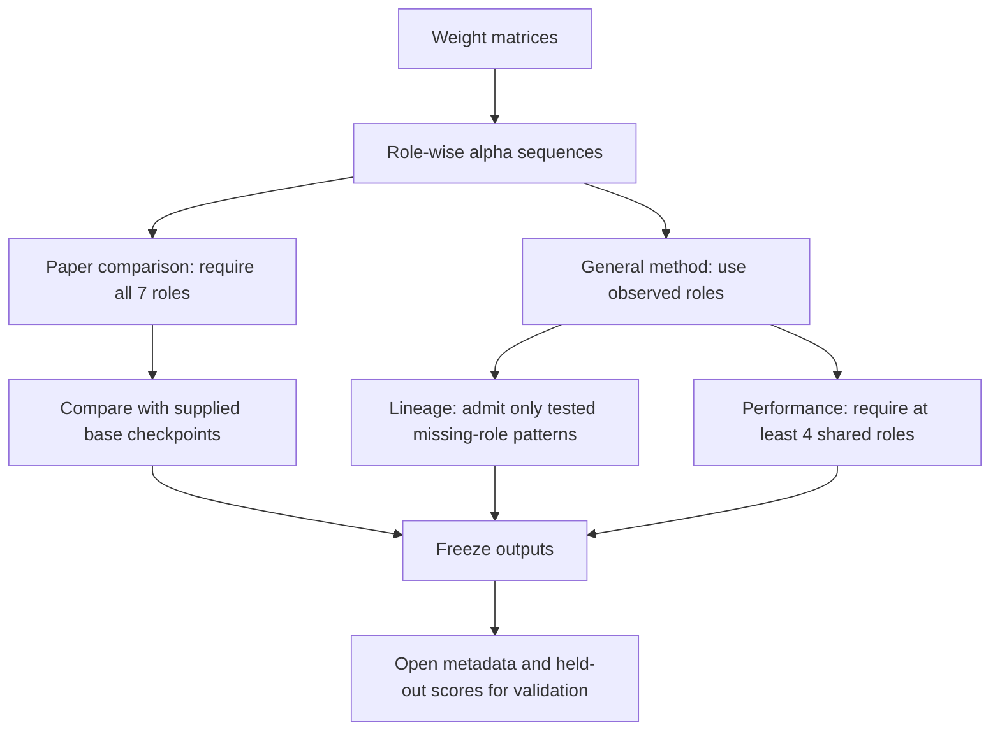
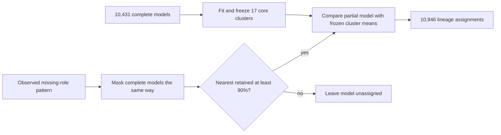
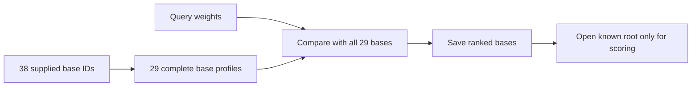
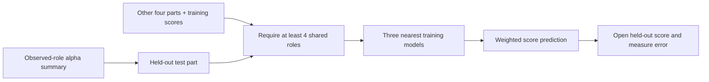

# Metadata-isolated HTSR study

Current run:
`research_runs/htsr_weight_only/runs/weight_only_2a5abfeb98dc33d9662c`

Reference paper:
`archive/reference-work/Spectral Signatures of Large Language Models.html`

Heavy-tailed self-regularization (HTSR) describes the eigenvalue distribution
of a model's weight matrices. This study uses those weight measurements for two
different tasks:

1. group related models and compare them with supplied base checkpoints;
2. predict benchmark scores from models with known scores.

Lineage, family, architecture, model type, parameter count, source collection,
and ancestry links are hidden while predictions are made. They are joined only
after predictions are saved, to measure correctness. Performance prediction is
supervised: benchmark scores from the training folds are allowed, but the held-
out model's score is not.

## Weight measurements

For a weight matrix `W`, the collector computes the singular values of `W` and
squares them. These are the eigenvalues of `W^T W`. It fits a power law to the
upper part of that distribution:

```text
p(lambda) is proportional to lambda^(-alpha)
```

The stored `alpha` uses WeightWatcher's DKS fit. DKS chooses the lower end of
the fitted tail by minimizing the Kolmogorov-Smirnov distance between the data
and the fitted power law.

The analysis recognizes seven common transformer matrix roles:

- attention query, key, value, and output;
- feed-forward gate, up, and down.

For each observed role:

1. order alpha values by layer depth;
2. scale depth from 0 to 1;
3. interpolate 32 positions;
4. replace alpha values by their rank within that role;
5. center and normalize the 32 ranks.

This makes models with different layer counts comparable. It compares the
order in which alpha rises and falls through layers, not its absolute scale.

## Two analysis boundaries



The seven roles remain fixed for the paper comparison. Outside that comparison,
a model does not need all seven roles. Missing roles are not filled with zeros,
means, or learned values.

## Data coverage

The Phase 2 and ablation source lists contain 19,713 distinct model IDs. Weight
analysis completed for 12,553. The two tasks use different coverage rules:

| Set | Phase 2 | Ablation | Total |
| --- | ---: | ---: | ---: |
| Complete seven-role core | 7,590 | 2,841 | 10,431 |
| Lineage after masking checks | 7,802 | 3,144 | 10,946 |
| Performance with at least four roles | 8,422 | 3,379 | 11,801 |

The source data is read-only. Caches, predictions, and reports are written under
`research_runs/`.

## 1. Lineage discovery

### Step 1: fit a stable core without labels

Only the 10,431 complete seven-role models define the cluster geometry. Each
model has a `7 x 32 = 224` value vector. MiniBatch K-means is fitted for 14
candidate cluster counts from 2 to 103. The count with the highest cosine
silhouette is selected. No family label is used.

The selected core has 17 clusters:

| Internal check on the core | Result |
| --- | ---: |
| Cosine silhouette | 0.607 |
| Mean adjusted Rand index across three new random seeds | 0.944 |
| Lowest adjusted Rand index across those seeds | 0.883 |
| Davies-Bouldin index | 1.541 |

Cosine silhouette measures separation; higher is better. The adjusted Rand
index measures whether repeated runs group the same model pairs together; 1 is
exact agreement. The Davies-Bouldin index compares within-cluster and between-
cluster spread; lower is better.

### Step 2: test each missing-role pattern

The study samples 1,200 complete models. For every missing-role pattern found in
the data, it hides those same roles from the complete models and recomputes
neighbors. A pattern passes when the nearest model from the complete profile is
still among the ten nearest masked profiles at least 90% of the time.

Examples:

| Observed roles | Models with pattern | Nearest retained in top 10 | Lineage use |
| --- | ---: | ---: | --- |
| query, key, value, output | 388 | 97.4% | include |
| query, key, value, up, down | 66 | 96.3% | include |
| query, output, gate, up, down | 836 | 86.4% | exclude |

This rule uses only weight measurements and role presence. It does not inspect
lineage or benchmark scores.

### Step 3: attach reliable partial profiles



Reliable patterns add 515 models. Each added model is compared with the 17
frozen core means using only its observed roles. This preserves the original
core assignments and cluster count.

Each cluster is named by the observed core model closest to its mean. That model
is a useful representative; it is not assumed to be the historical parent.
Weight similarity does not determine which model came first.

### Step 4: freeze, then validate

After assignments are saved and hashed, three lineage label sets are joined:

| Validation labels | Models | Label groups | Adjusted Rand | Normalized mutual information | Purity |
| --- | ---: | ---: | ---: | ---: | ---: |
| Human-reviewed broad family | 174 | 11 | 0.913 | 0.931 | 0.931 |
| Broad family where metadata rules agree | 2,981 | 11 | 0.924 | 0.918 | 0.939 |
| Individual root from the metadata graph | 5,013 | 529 | 0.600 | 0.754 | 0.660 |

Normalized mutual information measures shared grouping information; 1 is exact
agreement. Purity is the fraction of models that match the majority label in
each predicted cluster. Purity can be inflated by making many small clusters,
so it is reported with the adjusted Rand index.

The broad-family result is nearly unchanged from the strict core while covering
515 more models. Agreement with individual roots is lower because 17 weight
groups cannot represent 529 separate root IDs.

## 2. Supplied-base comparison

This is the paper-style test. A fixed candidate list is supplied before
prediction. Every query is compared directly with every candidate that has a
complete seven-role profile.



| Result | Value |
| --- | ---: |
| Supplied / usable bases | 38 / 29 |
| Scored queries | 3,836 |
| Overall top-1 | 82.27% |
| Equal-weight-per-root top-1 | 84.07% |
| Overall top-3 | 98.41% |
| Equal-weight-per-root top-3 | 98.63% |

The reference paper reports 98.44% overall top-1 on 128 derivatives and eight
bases. Our test is larger and harder, but it is not an exact replication: the
paper uses fixed-tail Hill alpha and a different unequal-depth alignment; this
study uses stored DKS alpha and normalized-depth interpolation. The accuracy gap
therefore does not rank the estimators.

This test answers, "Which supplied base is most similar?" It cannot return a
base that is absent from the list.

## 3. Performance prediction

### Step 1: choose role coverage without scores

The same masking experiment tests minimum role counts. The observed mixture of
missing-role patterns first reaches the 90% nearest-retention rule at four
roles, covering 11,801 models. This choice is made before benchmark scores are
read.

The result is not monotonic because each row contains a different mixture of
actual missing-role patterns. For example, the common five-role pattern without
key and value is weaker than the four-attention-role pattern.

### Step 2: make five fixed test parts

An exact hash is computed from each observed-role summary. Identical summaries
are assigned to the same one of five parts. Each part is tested once using only
the other four. This prevents an exact duplicate summary from appearing in both
training and test data.
Very similar but non-identical models can still appear in different parts; the
whole-group test below is the stronger check against that form of overlap.

### Step 3: predict from comparable neighbors

For each held-out model:

1. discard training models that share fewer than four roles;
2. find the three most similar remaining alpha summaries;
3. weight each training score by `1 / (1 - similarity + 0.000001)`;
4. save the weighted score average;
5. open the held-out score and measure error.



Modern and legacy leaderboard generations are trained and evaluated separately.

### Step 4: ordinary held-out results

| Target | Models | Unique summaries | Mean absolute error | Spearman | Training-mean error |
| --- | ---: | ---: | ---: | ---: | ---: |
| Modern six-task average | 2,537 | 2,410 | 3.043 | 0.875 | 8.458 |
| Legacy six-task average | 3,515 | 3,363 | 3.188 | 0.897 | 10.530 |

Mean absolute error is the average absolute score error. Spearman correlation
measures agreement in score ranking; 1 is exact rank agreement.

The broader method covers 394 more modern and 519 more legacy scored models than
the strict seven-role method. Its ordinary error is slightly higher: strict
errors were 2.845 modern and 3.085 legacy. The gain is coverage, not improved
interpolation accuracy.

### Step 5: hold complete weight groups out

The harder test keeps every member of a weight-derived cluster in the same test
part. A model is then predicted without any training example from its own
cluster.

| Target | Three-neighbor error | Spearman | Training-mean error |
| --- | ---: | ---: | ---: |
| Modern six-task average | 7.721 | 0.479 | 9.102 |
| Legacy six-task average | 14.169 | 0.032 | 13.182 |

Modern scores retain some signal and beat the mean baseline. Legacy scores do
not: rank correlation is near zero and error is worse than the mean baseline.
Performance prediction should therefore be treated as local interpolation. It
should display neighbor similarity and decline to predict when suitable
neighbors are absent.

## Collection limitation found in this study

The historical collector rejected every linear matrix with aspect ratio at
least 8. This removed legitimate narrow key/value and feed-forward projections
for some architectures. It also split any 3:1 attention matrix as fused query,
key, and value, even when the layer was already named `k_proj` or `v_proj`.

The collector now preserves named transformer projections and splits only names
that indicate a fused query-key-value matrix. This affects future collection;
it does not alter existing source data. A clean recollection is required to
recover matrices that were skipped in the current artifacts.

## Conclusion

- Keep the seven-role method for direct paper comparison.
- Use the 10,431 complete profiles as the stable unlabeled clustering core.
- Add partial lineage profiles only when their exact missing-role pattern passes
  the masking check; this gives 10,946 assignments without reducing broad-family
  agreement.
- Use the four-shared-role method for wider performance coverage, but report its
  small interpolation cost and weak legacy extrapolation.
- Do not claim exact parents, training direction, or reliable prediction in a
  weight region absent from training.

## Reproduce

```bash
python scripts/htsr_weight_only_study.py \
  --study-run research_runs/htsr_study/runs/htsr_7f739673cde388be2d4c \
  --validation-run research_runs/htsr_scaleup/runs/scaleup_05d8fb3a8bea1b39f713
```

Run directories and caches include source and implementation hashes. A cache is
reused only when its source data, role definitions, and implementation match.

## Reference

- [Spectral Signatures of Large Language Models](https://arxiv.org/html/2607.03377v1)
