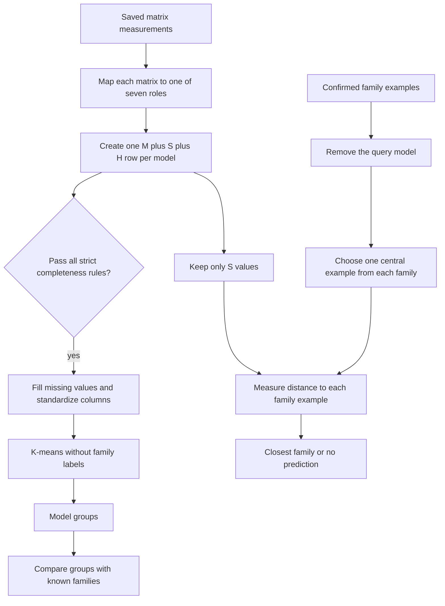
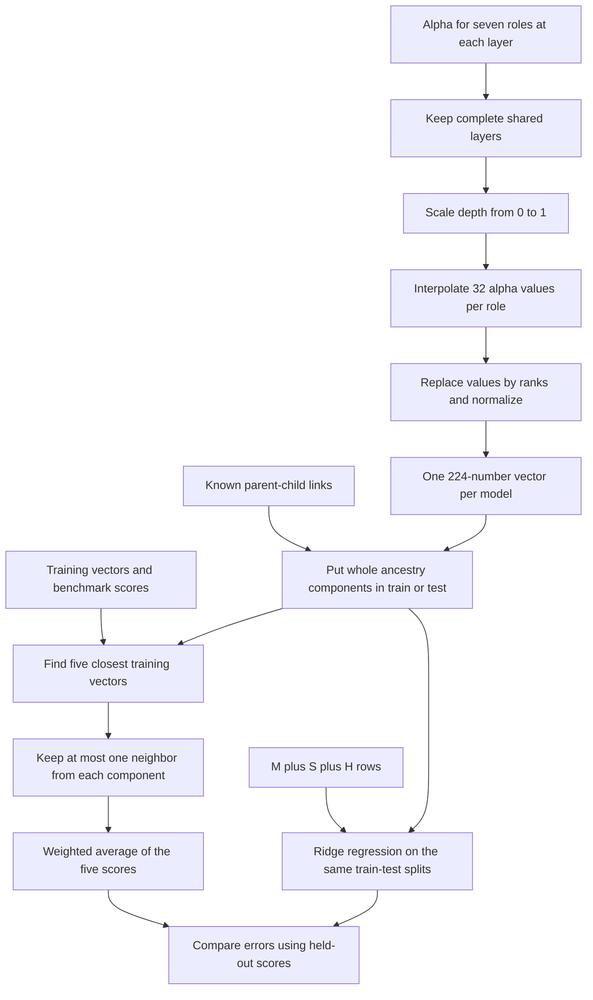

# HTSR Lineage and Performance Study

Method version: `htsr-combined-study-v4`

Main study output: `research_runs/htsr_study/runs/htsr_7f739673cde388be2d4c`

Larger study output: `research_runs/htsr_scaleup/runs/scaleup_f500d13ec545609d70b5`

Local paper copy: `archive/reference-work/Spectral Signatures of Large Language Models.html`

## What this study does

Heavy-Tailed Self-Regularization (HTSR) describes how the squared singular
values of a neural-network weight matrix `W` are distributed. These are the
eigenvalues of `W^T W`. The saved analysis fits a power law to the largest of
those eigenvalues:

```text
p(lambda) is proportional to lambda^(-alpha)
```

Here, `lambda` is one squared singular value and `alpha` is the fitted exponent.
We use this saved alpha and other matrix measurements to answer two questions:

1. **Lineage discovery:** Do models from the same known family fall into the same
   groups, and can we predict a known family for a model?
2. **Performance prediction:** Can the matrix measurements predict a model's
   average benchmark score without running the benchmarks again?

The two questions use the same source files but different final methods. For
lineage, the current default is K-means clustering with model-size, spectral,
and HTSR values. For performance, the current default finds training models
whose alpha values change through the layers in a similar order.

These methods measure similarity. They do not prove that one model was trained
from another, and they do not reliably identify an exact parent model.

## How matrix files become model-level numbers

The source tables are read-only. New tables and caches are written under
`research_runs/`.

The inputs are:

- model identifiers and architecture metadata;
- known parent-child links;
- one row of matrix measurements for each saved weight matrix;
- known model-family labels for evaluation and family prediction; and
- modern and legacy leaderboard scores, which are analyzed separately.

A connected set of parent-child links is called an **ancestry component**. Two
models in the same component are treated as related, even if there is no direct
edge between them.

Each matrix name is mapped to one of seven transformer roles:

1. attention query;
2. attention key;
3. attention value;
4. attention output;
5. feed-forward gate;
6. feed-forward up projection; and
7. feed-forward down projection.

A **feature** is one numeric input for one model. Features are kept in three
named groups:

| Group | Numbers included |
| --- | --- |
| **M: model structure** | Layer count, matrix row and column counts, which of the seven roles are present, the fraction of layers containing each role, and the base-10 logarithm of the total parameter count in those matrices. |
| **S: other spectral values** | Average weight size, largest squared singular value, entropy of the squared singular values, and stable rank divided by matrix rank. These do not use alpha. |
| **H: HTSR values** | Alpha, `alpha * log10(spectral norm)`, and `log10(sum(lambda^alpha))` from the saved WeightWatcher output. |

The S calculations use the squared singular values `lambda_1, ..., lambda_n`:

- average weight size is stored as
  `log10(sqrt(sum(lambda) / (matrix rows * matrix columns)))`;
- spectral norm is WeightWatcher's name for `max(lambda)` here, and the feature
  uses its base-10 logarithm;
- normalized spectral entropy is near 1 when the total `sum(lambda)` is spread
  evenly across many directions and near 0 when a few directions dominate; and
- stable rank is `sum(lambda) / max(lambda)`. We divide it by the ordinary matrix
  rank so matrices of different sizes can be compared.

For each role and each matrix measurement, values are ordered from the first
layer to the last. That ordered list is reduced to four numbers:

- the median;
- the interquartile range, which is the 75th percentile minus the 25th;
- the slope of a fitted straight line after depth is scaled from 0 to 1; and
- the fraction of expected layer values that are missing.

**Role coverage** means the fraction of model layers with a saved matrix row for
one role. **Feature coverage** means the fraction of requested feature values
that are valid numbers.

The saved alpha is WeightWatcher's power-law estimate. The paper instead uses a
Hill estimator, which computes alpha from a fixed number of the largest
eigenvalues. The source files do not contain the full eigenvalue lists, so the
paper's alpha cannot be reconstructed exactly.

## 1. Lineage discovery

Lineage discovery has two outputs:

- **Unlabeled clustering:** group models without showing K-means any family
  labels.
- **Known-family prediction:** compare a model with examples from each confirmed
  family and return the closest family, or return no prediction when too many
  values are missing.



### Unlabeled clustering: exact steps

1. **Standardize model identifiers.** Join matrix measurements, metadata, and
   parent-child links by the normalized model identifier. A filename alone is
   not used as identity.
2. **Create one row per model.** Calculate the M, S, and H numbers defined above.
3. **Apply the strict completeness rules.** Keep a model only when:
   - it uses the expected feature-table version;
   - all seven roles are present;
   - no saved row combines more than one role;
   - every role appears in at least 80% of the model's layers; and
   - at least 80% of all requested M, S, and H values are valid numbers.
4. **Prepare the matrix used by K-means.** Remove a column if it has no valid
   value for any model. Replace other missing entries with that column's median.
   Then subtract each column's mean and divide by its standard deviation so that
   columns with large numeric units do not dominate the distance.
5. **Choose the number of groups without labels.** For `N` remaining models, use
   `K = ceiling(sqrt(N / 2))`. The current strict set has 7,534 models, so
   `K = 62`.
6. **Run K-means.** K-means assigns each model to the nearest center and updates
   each center to the mean of its assigned rows. It minimizes the total squared
   Euclidean distance from rows to their assigned centers. Euclidean distance is
   the square root of the sum of squared column differences. We use random seed
   17 and try 20 initial sets of centers.
7. **Read family labels only after clustering.** Once the 62 assignments are
   fixed, compare them with confirmed families using:
   - **Adjusted Rand index (ARI):** agreement between all pairs of models, with a
     correction for agreement expected by chance;
   - **Normalized mutual information (NMI):** how much knowing the cluster reduces
     uncertainty about the family, scaled from 0 to 1;
   - **matched family recall:** pair clusters and families one-to-one, then average
     the recovered fraction within each family; and
   - **silhouette score:** compare each model's average distance inside its own
     cluster with its distance to the nearest other cluster.
8. **Record exclusions.** Every Phase 2 model is marked as strictly clustered,
   included only in the less strict calculation, below the required coverage, or
   missing a spectral file.

### Known-family prediction: exact steps

The audited family test predicts each query independently:

1. Use only the S values. In the audit, adding H values did not improve the
   average first-choice accuracy across families.
2. Remove the query model from the known examples. This prevents a model from
   being compared with itself.
3. For each S column, subtract the median of the remaining known examples and
   divide by their interquartile range.
4. Within each family, compute the median value of every scaled S column. Select
   the actual family member with the smallest root-mean-square distance to those
   medians. This selected model is the family's comparison example.
5. Compare the query with each family's selected example. Use only columns that
   are valid for both models, and compute their root-mean-square difference.
6. If fewer than 80% of the requested columns are shared, return no prediction
   for that family.
7. Convert distance `d` to `1 / (1 + d)` and choose the family with the largest
   value. This number is useful for ranking families, but it is not a probability.
8. Test behavior on an unseen family by removing every member of one family from
   the known examples. Measure whether its scores are lower than scores for
   families that remain in the known set.

The larger, less strict clustering keeps any model with at least 80% valid M, S,
and H values. It does not require all seven roles, 80% layer coverage per role, or
the no-combined-role rule. For its displayed family suggestions, it compares each
model directly with the median S row of each family. These suggestions are for
manual review; they are not accepted as ancestry labels.

### Current lineage result

- The Phase 2 table has 15,000 models, of which 8,892 have a saved HTSR file.
- Strict clustering has 7,534 models and 62 clusters. It reaches ARI 0.850, NMI
  0.905, and matched family recall 0.847.
- The less strict calculation has 8,284 models. Across different random seeds and
  nearby values of `K`, ARI ranges from 0.807 to 0.920 and NMI from 0.911 to
  0.931.
- The audited family test has 174 queries from 11 families. Its first-choice
  accuracy is 0.96884 after accuracy is calculated within each family and then
  averaged across families.
- Exact-parent first-choice accuracy is 0.065. The measurements are useful for
  model-family grouping, not exact parent recovery.

## 2. Performance prediction

The current performance method is **five-nearest-neighbor prediction**. For a
test model, it finds five training models with the most similar layer-by-layer
alpha ordering and averages their known benchmark scores. This is also called
`k`-nearest neighbors (kNN), where `k = 5`.

The comparison method is **Ridge regression**. Ridge fits a linear equation from
the M, S, and H features to the benchmark score while adding a squared penalty
to large coefficients.



### Turn per-layer alpha values into one vector

1. For each model, find layer depths where all seven roles have a valid alpha.
   Require at least two such depths and require alpha to vary within every role.
2. Map the first retained depth to 0, the last to 1, and all other depths between
   them. This makes depth comparable across models with different layer counts.
3. For each role, estimate alpha at 32 evenly spaced positions from 0 to 1. Between
   two observed layers, use the value on the straight line joining them.
4. Replace the 32 alpha values by their rank order within that role. Ties receive
   their average rank. This keeps the ordering through depth and removes the
   absolute alpha scale.
5. Subtract the mean rank. Divide by the vector length
   `sqrt(sum(value^2))`, so each role vector has length 1.
6. Join the seven 32-number role vectors. The result is one 224-number vector for
   the model.

For models `i` and `j`, let `v(i, r)` be the normalized 32-number vector for role
`r`. Their similarity is:

```text
similarity(i, j) = (1 / 7) * sum over roles dot(v(i, r), v(j, r))
```

The result lies between -1 and 1. A value near 1 means alpha rises and falls in a
similar order through depth for the two models. It does not mean that their alpha
values have the same magnitude.

The paper-style comparison aligns the two models' layers in order and then
computes a Spearman rank correlation for each role. Spearman correlation compares
rank order rather than raw values. Our 32-position calculation is faster on a
large model set. On the earlier 302-model cache, its pairwise similarities had
Spearman correlation 0.783 with the paper-style calculation. For each model, the
two calculations shared an average of 84.4% of their three nearest neighbors.

The 224-number vectors are cached on disk. The cache name depends on the source
file contents, selected model identifiers, and method settings. It is reused
until any of those inputs change.

### Train and evaluate the predictors

1. **Select usable rows.** Keep a model when it has a valid 224-number vector, all
   six scores needed for the chosen benchmark average, and membership in an
   ancestry component containing at least one known parent-child edge.
2. **Keep leaderboard generations separate.** The target is the mean of the six
   stored task scores from one leaderboard generation. Build one target for the
   modern leaderboard and another for the legacy leaderboard. Never use one to
   train the other.
3. **Make five train-test splits.** Put every model from one ancestry component
   entirely in training or entirely in test. Thus, no known relative of a test
   model can appear in its training split.
4. **Find five neighbors using training data only.** For each test model, rank
   training models by the vector similarity above. Keep at most one model from
   each training ancestry component, then take the first five.
5. **Predict from their scores.** For neighbor similarity `s`, use
   `weight = 1 / (1 - s + 0.000001)`. Predict the weighted mean of the five known
   training scores. The small added number prevents division by zero.
6. **Fit Ridge regression on the same test splits.** Compare three input sets:
   M alone, M+S, and M+S+H. Within each training split:
   - remove columns that have no valid variation in training;
   - replace missing values using a median calculated from training rows;
   - standardize each column using only training rows; and
   - choose the Ridge penalty from `0.01, 0.1, 1, 10, 100` using four smaller
     training-only splits that also keep ancestry components whole.
7. **Stop large families from dominating Ridge.** Give each training model weight
   `1 / number of models in its ancestry component`. Use these weights when
   calculating missing-value medians, standardizing columns, and fitting Ridge.
8. **Calculate errors on the same held-out models.** Report:
   - **mean absolute error (MAE):** the average of
     `abs(predicted score - actual score)`;
   - **component-weighted MAE:** calculate MAE inside each ancestry component,
     then average the component values so each component counts equally;
   - **model-weighted MAE:** average over models, so large components count more;
     and
   - **Spearman and Kendall correlations:** two measures of whether predicted and
     actual models have a similar score ordering.
9. **Measure uncertainty across ancestry components.** Resample whole components
   2,000 times to form a 95% interval for the MAE difference. Also run 10,000
   random sign flips of the paired component differences to obtain a p-value.
   This p-value is the fraction of sign-flipped trials whose absolute mean
   difference is at least as large as the measured difference.
   When individual benchmark tasks are tested together, Holm's correction lowers
   the chance of declaring any task improved just because many tasks were tried.

The held-out benchmark scores are read only after both methods have predicted
them. They are not used to build alpha vectors, choose neighbors, select the
Ridge penalty, replace missing values, or standardize columns.

### Checks that do not count as the main result

- The paper-like check repeats a random 50/50 model split 100 times and uses three
  neighbors. Related models can appear on both sides, so this measures prediction
  when close relatives are already in training. It does not test a new ancestry
  component.
- The ablation collection helped us choose methods. Results on it describe these
  collected models, but they are not an independent test chosen before method
  development.
- We also tried using alpha neighbors to predict the error left by Ridge
  regression. This two-stage predictor did not reduce error reliably, so it is
  not used.

### Current performance result

- On the modern leaderboard, both methods predict the same 649 held-out models
  from 139 ancestry components. Five-nearest-neighbor alpha prediction has MAE
  3.082; M+S+H Ridge has MAE 3.455. The alpha method lowers MAE by 0.373 points.
  Resampling components gives a 95% improvement interval from 0.037 to 0.727, and
  the paired sign-flip p-value is 0.037.
- On the legacy leaderboard, 348 models from 122 ancestry components can be
  evaluated this way. The alpha method lowers the six-task-average MAE by 1.328
  points compared with M+S+H Ridge. The 95% improvement interval is 0.554 to
  2.104, and the p-value is 0.0013.
- These results come from ancestry-separated splits of the data used in this
  study. A later model collection that played no part in method selection is
  still needed to measure performance on fully new data.

## Current method choice

- Use strict M+S+H K-means clustering for the main lineage map.
- Use S-only known-family prediction, and return no family when shared values are
  below 80%.
- Show the less strict clusters and family suggestions only for manual review,
  with each model's available-value fraction shown.
- Use five-nearest-neighbor alpha prediction with at most one training neighbor
  from each ancestry component for benchmark scores.
- Keep M+S+H Ridge regression as the linear comparison.
- Do not use the two-stage Ridge-error predictor.
- Do not present random model splits as evidence for a new model family.

## Run the larger study

```bash
PYTHONPATH=. python scripts/htsr_scaleup_study.py \
  --study-run research_runs/htsr_study/runs/htsr_7f739673cde388be2d4c
```

The script reads paths and settings from the main study output. It names the new
output using a hash: a short code calculated from the input contents and settings.
The same inputs produce the same code. The script does not change the source data.
