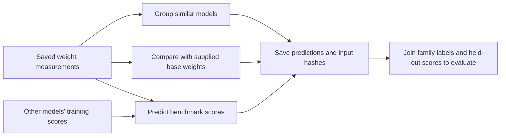
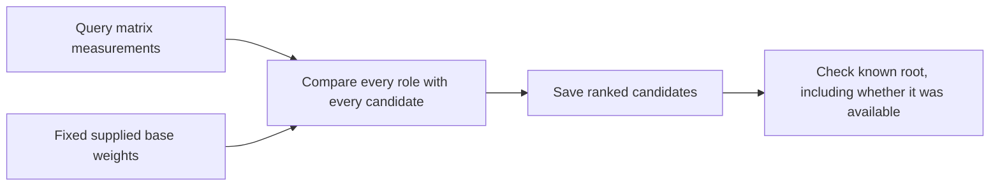

# What model weights tell us

## Status

Documentation updated October 24, 2026. The results below are the completed
September 2026 experiments; the
[October 23 scale-up plan](research/scaleup/model_zoo_frontier_research_plan_2026-10-23.md)
describes the next research phase. It proposes task-specific model selection
under deployment constraints and an evaluation budget. Its hybrid comparison
would add documentation and historical evaluations alongside the existing
weight-only scientific track.

This is an exploratory reassessment of saved weight analyses, not a new test on
previously untouched models. The earlier family-grouping run is retained:
`research_runs/htsr_weight_only/runs/weight_only_2a5abfeb98dc33d9662c`.
The reassessment and its input hashes are under `research_runs/htsr_reassessment/`.
The completed reassessment is `reassessment_0063666fd5733b453c38`.

The main correction is to separate three questions:

1. **Grouping:** which models have similar weight measurements?
2. **Base matching:** which supplied base checkpoint is most similar?
3. **Score prediction:** what benchmark score can be learned from weight
   measurements and other models' known scores?

These need not use the same representation. Rank comparisons retain the order
of alpha values through layers but discard their level and spread. That can help
family matching while removing information useful for score prediction.

## Data and its limits

The input lists contain 19,713 repository records. They are not a random sample
of all models, and distinct repository names do not imply independent weights.
Ignoring letter case gives 19,708 repository IDs. These source-list duplicates
are distinct from the spectral and checkpoint overlap checks on scored models.

| Stage | Phase 2 | Ablation | Total |
| --- | ---: | ---: | ---: |
| Selected repository records | 15,000 | 4,713 | 19,713 |
| Saved matrix-statistics files | 8,892 | 3,661 | 12,553 |
| Complete seven-role sequences | 7,590 | 2,841 | 10,431 |
| Earlier accepted family-group assignments | 7,802 | 3,144 | 10,946 |
| Earlier performance pool: at least four roles | 8,422 | 3,379 | 11,801 |

### How much can layer-wise grouping cover?

| Collection | Grouped / analyzed | Share of analyzed | Share of selected records |
| --- | ---: | ---: | ---: |
| Phase 2 | 7,802 / 8,892 | 87.7% | 52.0% |
| Ablation | 3,144 / 3,661 | 85.9% | 66.7% |
| Combined | 10,946 / 12,553 | 87.2% | 55.5% |

The combined total includes 10,431 complete seven-role sequences and 515 accepted
partial sequences. Of the analyzed models, 1,607 remain unassigned under the
current representation and missing-role checks. Another 7,160 selected records
have no completed historical analysis; they were never tested by this grouping
method.

Coverage is strongest for the transformer layouts represented by the seven
roles. Normalized layer depth handles different layer counts, and the masking
check admits particular missing-role patterns. The method still uses a fixed
role vocabulary. These counts do not demonstrate comparable accuracy on unseen
architectures or independent model families.

Phase 2 combines the Model Atlas graph, sampled metadata, leaderboard records,
and targeted Hugging Face searches. Selection tries to cover base models,
fine-tunes, adapters, merges, quantized models, mixture-of-experts models, and
multimodal models. These are metadata-based selection categories, not verified
mutually exclusive model properties.

Ablation starts from leaderboard records and removes overlap with Phase 2,
inaccessible candidates, and duplicate records. Its requested cap was 5,000;
4,713 survived selection. It is score-enriched, not a controlled intervention
on one training variable. Modern and legacy leaderboard tasks remain separate.
Phase 2 has 2,922 rows with an average score after checking both merged average
columns, not the 2,291 indicated by its older status flag.

The newer all-matrix summaries accept 12,365 saved analyses with at least two
finite alpha estimates above 1, without requiring any of the seven roles. They
cover 2,641 modern and 3,817 legacy average-score targets. This broadens analysis
of the **matrices actually saved**; it does not recover matrices omitted during
collection or establish support for every architecture.

### Historical checkpoint identity is unresolved

Historical analyses do not record the resolved checkpoint commit. Benchmark records
sometimes do. Repository matching therefore does not prove that the score and
analyzed weights refer to the same revision.

In the expanded scored population, 210 models have both modern and legacy
benchmark commits recorded; 164 have different commits. Among 79 comparable
legacy Phase 2 records, 66 disagree with the Phase 2 source commit. Different
commits do not by themselves
prove different tensors, but the missing analysis commit prevents verification.
All score results below must be read with this limitation.

Source files are unchanged. Derived tables, predictions, and audits live in
`research_runs/`. Future collection must record requested and effective
repositories, resolved commits, adapter and base commits, and benchmark identity.

The [newer operational collector](/jumbo/yaoqingyang/kinshuk/Model-Zoo/docs/operations/analysis.md)
now requires pinned model and adapter-base revisions, stores canonical matrix
identities, saves full computed spectra by default, and records analyzed/skipped
coverage. These capabilities apply to its newer records. The historical data
used here has not been replaced, and the benchmark experiments have not been
rerun on that collection. Completed collection can still have partial matrix
coverage, so a successful record alone is insufficient for a comparison.

## Allowed information

No family label, ancestry link, architecture annotation, repository-name text,
or collection label is a numeric predictor input. Matrix dimensions measured
from tensors are allowed as a control; they are not annotated metadata.

Metadata still shapes collection and the supplied candidate-base list. Collection
identity also defines a transfer test, but is not a fitted feature. Score
prediction is supervised: it needs training scores, just as the paper's
three-neighbor predictor does. The test model's score is excluded from fitting.

## Weight measurements

For each matrix `W`, squared singular values give the eigenvalues of `W^T W`.
Heavy-tailed self-regularization (HTSR) studies their distribution, including a
power-law tail: `p(lambda) proportional to lambda^-alpha`.

The historical collector used a custom DKS-style maximum-likelihood fit: try
different tail starts and choose the smallest Kolmogorov-Smirnov distance between the
observed and fitted distributions. This is not the paper's fixed-half-tail Hill
estimator. Saved `xmin` is the smallest retained eigenvalue, **not the fitted-tail
start**. Saved `norm` is the sum of retained eigenvalues, approximately the
squared Frobenius norm of the matrix.

Scalar alpha cannot be converted back to Hill alpha. Sampled HDF5 files contain
alpha only. Exact replication needs saved eigenvalues where available or another
pass over checkpoint weights. Historical collection also skipped some narrow
projections; accepting partial sequences cannot reconstruct those matrices.
In that historical corpus, full eigenvalue arrays were found for only 17 of the
12,553 analyzed models.
Even a complete spectrum omits the singular vectors: rotating matrix coordinates
can preserve every singular value. Equal spectra therefore do not prove equal
weights, shared training history, or an exact parent relationship.

## 1. Grouping related models

### Step 1: compare layer-wise alpha order

Recognize query, key, value, attention output, and feed-forward gate, up, and
down matrices. For each role, order alpha by layer, map depth to 0 through 1,
interpolate 32 positions, and center and normalize the ranks of those values.
The complete vector has `7 x 32 = 224` entries.

The older complete-role builder uses depths observed for all roles. The
partial-role builder uses each role's observed depths independently. They are
related but not identical transformations. Neither recreates missing weights.

### Step 2: choose groups without labels

MiniBatch K-means compares 14 cluster counts between 2 and 103 on 10,431 complete
models. Cosine silhouette, a measure of within-group versus between-group
separation, selects 17 groups with value 0.607. Three other seeds give mean
grouping agreement 0.944 and minimum 0.883, measured by adjusted Rand index.
That index is 1 for identical grouping, after correcting for chance.

This describes a zoo used during fitting; it is not an unseen-family test.
The distance and candidate cluster counts matter.

### Step 3: add partial sequences cautiously

Hide each observed missing-role pattern on 1,200 complete models. Accept a
pattern when the original closest model remains among the ten closest at least
90% of the time. This adds 515 models to the fixed groups: 10,946 assignments.
The heuristic checks neighbor retention, not lineage correctness on arbitrary
new architectures.

The representative is the actual core model closest to a group mean, not
necessarily the historical base. The galaxy is an illustrative layout; its
visual distances and connecting curves are not ancestry evidence.

### Step 4: save assignments, then compare labels

| Validation source | Models / label groups | Adjusted Rand index | Purity |
| --- | ---: | ---: | ---: |
| Human-reviewed broad family | 174 / 11 | 0.913 | 0.931 |
| Broad family where metadata rules agree | 2,981 / 11 | 0.924 | 0.939 |
| Root ID assigned by the metadata graph | 5,013 / 529 | 0.600 | 0.660 |

Purity is the fraction matching the most common validation label in each group.
It can rise simply by making more small groups. Graph roots are inferred
validation labels, not independently verified parent checkpoints. Seventeen
groups cannot distinguish 529 root IDs; this helps explain disagreement but does
not prove that all disagreement is harmless.

### Broader alternative checked

Clustering the 30 all-matrix quantiles covers 12,365 models without role names.
Standardized Euclidean silhouette selects four clusters from counts 2, 4, 8, 16,
32, and 64. On the same validation models, broad-family adjusted Rand index is
only 0.278, versus 0.924 for layer-wise ranks; manual agreement is 0.258 versus
0.913. This broader summary is not an adequate replacement. The comparison
suggests layer and role detail matter, but does not isolate which discarded
information is responsible.

## 2. Matching supplied bases

Of 38 supplied base IDs, 29 have usable sequences. The reassessment compares
methods on the **same 3,802 scored queries and 29 bases**:

| Method | First choice correct | First three include root | First choice, equal weight per root |
| --- | ---: | ---: | ---: |
| Earlier interpolated DKS-alpha ranks | 82.30% | 98.58% | 84.35% |
| Trace: layer-wise matrix norms | 85.19% | 99.29% | 88.26% |

Trace takes the square root of the saved norm, aligns both sequences to the
larger layer count, and averages Pearson correlations across the seven roles.
Pearson correlation compares centered changes in magnitude. This implements the
coarse norm-based step, not the newer paper's direct matrix-subspace checks.
[Trace paper](https://arxiv.org/html/2608.07786v1)

The gain is promising but modest. Trace requires complete, contiguous sequences
and excludes some earlier queries. Its similarity score only weakly separates
queries with an available root from those with an unavailable root: area under
the receiver operating characteristic curve is 0.676, where 0.5 is chance and 1
is perfect. The first-versus-second margin is worse, 0.442. Do not present that
margin as confidence or use it as a validated rejection rule.

There is a further limitation: 501 common queries have an exact first-versus-
second tie in at least one method. Removing those queries from both methods
leaves 3,301 queries and 28 roots. Overall first-choice accuracy then becomes
85.88% for alpha ranks and 84.73% for Trace; equal-weight-per-root accuracy still
favors Trace, 88.15% versus 85.26%. This post-hoc check changes the case mix and
does not prove tie-breaking caused the original gain. It does mean we should
retain both methods rather than declare a robust winner from the full-set mean.

## 3. Predicting benchmark scores

### Step 1: retain more than alpha ranks

Compare fixed methods on the same scored models:

- a training-set mean and median;
- the weighted score average of three nearest alpha-rank neighbors;
- ridge regression, a linear model with a penalty limiting coefficient size;
- gradient-boosted trees, small trees fitted successively to reduce error.

Inputs include alpha level and spread, spectral size, root-mean-square weight
magnitude, entropy, and stable rank. Role-aware summaries use median,
interquartile range, and slope through depth. Role-free summaries use five
quantiles of six measurements across all saved matrices. They change
normalization too, so this is not a pure role-removal test.

Ridge uses penalty 100. Trees use 200 iterations, at most 15 leaves, learning
rate 0.05, minimum leaf size 20, and penalty 10. These are fixed exploratory
settings, not tuned per test part. Imputation and scaling fit training rows only.
Raw-alpha-only, matrix-shape, and non-alpha spectral controls test what contributes.

### Step 2: make the test progressively harder

1. Rerun the older five-part split, with deterministic handling of tied neighbors.
2. Keep exact shared-role matches together, even when missing-role patterns
   differ. The old hash rule missed 7 modern and 118 legacy affected models.
3. Keep connected groups of near-matches together. An edge requires mean shared-
   role correlation at least 0.995. This sensitivity check is not a proven
   boundary between independent checkpoints.
4. Hold an entire earlier weight-derived cluster out of training.
5. Train on Phase 2 and test ablation, then separately reverse direction.
   Collection transfer does not guarantee unrelated families or checkpoints.

These are not certified independent checkpoints. The post-prediction audit still
finds two modern benchmark-commit groups, containing four models, crossing the
near-group parts. Other representations can also have identical summaries
despite different rank sequences. Those residual overlaps are recorded rather
than described as a leakage-free test.

### Step 3: compare errors on the same rows

Mean absolute error (MAE) is the average absolute difference between predicted
and observed score on a 0-100 scale. These are six-task average targets, not
errors for every individual task.

| Test | Modern: rank neighbors | Modern: spectral trees | Legacy: rank neighbors | Legacy: spectral trees |
| --- | ---: | ---: | ---: | ---: |
| Older five-part split, rerun | 3.057 | 2.875 | 3.202 | 2.725 |
| Exact shared-role groups kept together | 3.015 | 2.885 | 3.228 | 2.713 |
| Near-match groups kept together | 3.726 | 3.266 | 5.227 | 3.109 |
| Whole weight cluster held out | 7.717 | 7.239 | 14.169 | 9.510 |

Each row covers 2,537 modern or 3,515 legacy models. Spectral ridge is stronger
on the whole-cluster test: MAE 6.959 modern and 7.254 legacy, versus training-
median errors 9.089 and 13.506. It is not a reliable universal choice: in modern
collection transfer, 26 estimates fall outside 0-100, ranging from -130.66 to
504.81. Average error alone hides that failure.

The old neighbors' weak extrapolation did **not** establish that all spectral
measurements fail. These results also do not establish alpha as a universal
training-quality score. Average targets can hide large individual-task errors;
the reassessment saves task-level results using the same test parts.

Collection directions must not be pooled into one transfer claim. For example,
all-matrix spectral trees on the matched modern population give MAE 3.037 when
trained on 1,951 Phase 2 models and tested on 586 ablation models. Reversing
direction gives 5.764 on 1,951 Phase 2 test models. The difference reflects both
training-set size and collection differences; this experiment does not isolate
their separate effects.

### Step 4: check whether alpha adds information

On the same near-group test and fixed tree estimator:

| Input measurements | Modern MAE | Legacy MAE |
| --- | ---: | ---: |
| Matrix dimensions and role coverage only | 4.249 | 5.693 |
| Spectral measurements without alpha | 3.211 | 3.068 |
| The same measurements plus alpha summaries | 3.266 | 3.109 |

The non-alpha measurements are magnitude, spectral size, entropy, and stable
rank. They improve on the shape-only control. Adding alpha does not improve
this test. Without alpha, ridge also gives lower whole-cluster errors, 6.561
modern and 6.873 legacy, than the combined ridge model. The current evidence
supports spectral information, **not a demonstrated alpha-specific gain**.

On individual modern tasks, combined spectral trees have near-group error
11.402 for instruction-following evaluation (IFEval), versus 1.922 for GPQA
question answering. Neither task should inherit the average target's apparent
accuracy. The saved task table includes all six tasks and training-median
comparisons.

## Comparison with the paper

The reference reports 98.44% first-choice accuracy on 128 derivatives and eight
bases. We have more queries and bases, different labels, a different alpha
estimator, and different unequal-depth alignment. We have not shown a better
result under the same experiment. Its clustering uses raw alpha and dimensionality
reduction; our rank-vector K-means is an adaptation.
[Spectral Signatures of Large Language Models](https://arxiv.org/html/2607.03377v1)

The paper discusses five-part performance evaluation but also reports 100
repeated 249/250 train/test divisions on 499 models; some baselines use
leave-one-out evaluation. Its four-task errors cannot be ranked against our
modern or legacy six-task average. Our useful additions are broader coverage,
matched representation controls, and explicit transfer failures.

Earlier HTSR research motivates testing alpha and scale together within
comparable trained model series. It does not establish one monotonic alpha-to-
score law across architectures and benchmarks.
[Martin, Peng and Mahoney, 2021](https://www.nature.com/articles/s41467-021-24025-8)

## Decision

- Retain layer-wise ranks for broad grouping. More architectural coverage is not
  sufficient reason to replace them with weaker grouping evidence.
- Keep Trace beside alpha for supplied-base matching; the ranking is sensitive
  to exact ties and the root mix. Neither establishes exact
  parents, training direction, or safe unknown-root rejection.
- Use raw spectral measurements, not only ranks, for performance research.
  Keep non-alpha spectral trees as the simple leading baseline. Alpha remains
  a comparator, not an assumed source of improvement. Ridge exposes transfer
  signal but has serious out-of-range failures.
- Treat these results as exploratory and checkpoint-unverified. Use the newer
  collector for revision-pinned measurements and verified evaluation joins;
  collect the nine missing candidate bases and use saved eigenvalues for a
  matched Hill comparison.

Methods requiring singular vectors or direct products of weight matrices cannot
be recovered from scalar spectral statistics alone. They are follow-up options,
not implemented capabilities.
[Centered residual method](https://arxiv.org/html/2608.14929v1),
[assignment and weight alignment](https://arxiv.org/abs/2510.06738).

## Reproduce

See the root README for the build order. `scripts/htsr_reassessment.py` writes a
protocol with fixed settings, parent artifacts, inputs, and reused predictions.
A complete run has an artifact manifest. The dashboard and deck separate the
earlier study from reassessment evidence. Source data is never rewritten.

The independently recomputed identity, overlap, range, and collection-direction
checks are in the run's manifest-validated `audit/` subdirectories. Each audit's
manifest records consumed source hashes. A deterministic sample of 32 raw files
was rehashed against the extraction inventory; it is not a second full-file audit.
