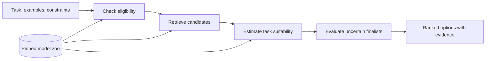

# Model Zoo Scale Up and Model Selection Research Plan

Research response from October 23, 2026. Exported October 24, 2026.

I recommend building **a model-selection engine backed by a large, revision-pinned zoo of weight measurements**. The research objective should be:

> Given a task, deployment constraints, and a limited evaluation budget, find a suitable model—and show the evidence behind that recommendation.

Your existing clustering, base matching, and performance prediction become components of that system. The strongest potential contribution is demonstrating that **weight evidence improves model selection when documentation and benchmark coverage are incomplete, while reducing the total cost of making a reliable choice**.

I reviewed the local study and reassessment, the newer `/jumbo/yaoqingyang/kinshuk/Model-Zoo` implementation and collection records, relevant saved chat sessions, neighboring research directories, and current papers and community discussions. Everything on the HPC server was read-only.

**The existing research gives us a foundation, with several clear boundaries.**

| Evidence I found | Implication for the next project |
|---|---|
| Layer-wise grouping produced 10,946 assignments; agreement with 2,981 broad-family labels was 0.924 adjusted Rand index. | Retain it as a useful organization and candidate-generation baseline. |
| Supplied-base matching reached roughly 82–85% first-choice accuracy, with ordering sensitive to tied candidates. | Treat it as candidate retrieval; historical parent identification remains an open task. |
| Spectral trees without alpha improved average-score prediction in the near-match-grouped evaluation. | Start with these simple predictors. Alpha must earn its inclusion. |
| Individual-task errors differed substantially; modern IFEval error was much larger than aggregate-score error. | Predict suitability for the requested task, rather than relying on one general quality score. |
| Historical analyses lack resolved checkpoint commits needed to verify benchmark joins. | Preserve historical results as exploratory; build definitive experiments from newly pinned records. |
| Newer production summaries contain 46 successful measurement records across 44 repository IDs. | The improved collector has bounded collection evidence, but sustained operation at thousands of models still needs demonstration. |

These findings are documented in the [current study](/scratch/kinshuk/Model-Research/docs/HTSR_STUDY.md) and [HPC operating documentation](/jumbo/yaoqingyang/kinshuk/Model-Zoo/docs/operations/analysis.md).

The newer collector already handles much of the difficult groundwork: revision pinning, canonical tensor identities, saved spectra, coverage records, supervised workers, bounded caches, and compatible resume. We should build on that investment.

**The literature changes what we can credibly claim as new.**

| Relevant work | What it establishes | Consequence for us |
|---|---|---|
| [Model Atlas](https://github.com/eliahuhorwitz/Model-Atlas) and [Model Lakes](https://arxiv.org/abs/2403.02327) | Organizing model populations through attributes, relationships, search, and versioning is an established research direction. | A large catalog and lineage visualization need additional scientific contributions. |
| [ModelLens, 2026](https://arxiv.org/abs/2605.07075) | Reports recommendation using 1.62 million evaluation records across about 47k models and 9.6k datasets. | A 50k-model recommendation system has a close competitor. |
| [ModelLakeFishing, October 2026](https://arxiv.org/abs/2610.04904) | Reports indexed retrieval over a catalog exceeding 3 million models using sparse relational evidence. | Catalog size and approximate nearest-neighbor search alone offer limited novelty. |
| [ProbeX, CVPR 2025](https://openaccess.thecvf.com/content/CVPR2025/html/Horwitz_Learning_on_Model_Weights_using_Tree_Experts_CVPR_2025_paper.html) | Learns useful attributes from weights within model trees, including weight-to-language alignment. | Weight-based semantic search and tree-specific predictors are important baselines. |
| [WeightCLIP, ICML 2026](https://proceedings.mlr.press/v306/asefaw26a.html) | Aligns dataset and weight representations for retrieval and other downstream tasks. | A contrastive task–model embedding is an established starting point. |
| [LLM Biometrics](https://arxiv.org/abs/2608.07786) and [Training Leaves Traces](https://arxiv.org/abs/2608.14929) | Study spectral, directional, and residual signatures for ancestry-related comparisons. | Lineage work needs strong comparisons and evaluation beyond supplied-base accuracy. |
| [tinyBenchmarks](https://arxiv.org/abs/2402.14992) and [SELECT-LLM](https://arxiv.org/abs/2510.09418) | Reduce evaluation or annotation requirements through selected examples. | Selective evaluation is useful, but its combination with our measurements needs a distinct benefit. |

A particularly recent baseline is [Why Heavy-Tailed Weight Spectra Predict Model Quality](https://arxiv.org/abs/2610.13123), submitted October 9. It introduces a final-layer spectral predictor. Its stated limitations include comparability across activation dimensions and failures for some architectures, so it should be evaluated within its applicable scope.

My inference from this literature is that our strongest opening lies at the intersection of **measured weights, poorly documented models, practical constraints, and evaluation cost**. That is a promising hypothesis; it is not yet a demonstrated novelty claim.

Community discussions support the practical problem. People ask which models fit their actual hardware, whether fine-tunes improve their own workloads, and how quantization and runtime settings affect results. These are useful signals for product design, rather than evidence of model quality. See this [hardware-constrained benchmarking discussion](https://www.reddit.com/r/LocalLLaMA/comments/1s47aur/im_building_a_benchmark_comparing_models_for_an/) and this [discussion of vetting community fine-tunes](https://www.reddit.com/r/LocalLLaMA/comments/1wyxukj/how_do_you_decide_whether_to_trust_a_community/).

**The first useful product should answer a narrow, consequential question well.**

For example:

> “Find a model for extracting structured fields from English support tickets. It must run on one 24 GB GPU. Here are 50 examples and my latency target.”

It should return a short list containing:

- The exact checkpoint and deployment configuration.
- Relevant observed evaluations and separately identified predictions.
- Evidence about memory, latency, and task compatibility.
- Uncertainty and missing information.
- A small comparison experiment that resolves the remaining uncertainty.

A model’s deployment identity includes its quantization, tokenizer, chat template, runtime, and workload settings. A recommendation for a base repository alone is often incomplete.

The core flow can remain straightforward:

I would initially support two query types: **choose a model for a task** and **find a cheaper replacement for a known model**. Later, add base-model selection for fine-tuning, model comparison, and provenance investigation.

Your earlier sessions explicitly requested prediction without metadata inputs. Preserve that scientific track. Alongside it, evaluate a practical hybrid system that can use documentation, historical evaluations, and deployment evidence. This makes the incremental value of weights measurable while allowing the product to answer constraints such as license and runtime compatibility.

**I would concentrate the research on three connected ideas.**

1. **Learn task suitability separately from model identity.**

   Family similarity and task suitability need different representations. Two checkpoints may share almost all their weights while differing materially in instruction following or coding performance.

   Retain the successful layer-wise representation for grouping. For performance prediction, start with magnitude, stable rank, spectral entropy, spectrum summaries, depth, and coverage masks. Compare these against alpha-containing versions.

   Then test a small task-conditioned predictor:

   \[
   \widehat y(m,q)
   =
   a(q)
   +u(q)^\top z_{\mathrm{global}}(m)
   +v(q)^\top z_{\mathrm{update}}(m).
   \]

   Here, \(q\) describes the task, \(z_{\mathrm{global}}\) describes the model, and \(z_{\mathrm{update}}\) describes changes from a compatible reference checkpoint when available.

   Begin with linear models and boosted trees. Introduce a layer-token encoder only if it improves decisions on held-out tasks or model lineages. Include layer position, matrix shape, and missingness so that heterogeneous structures retain useful detail.

   The decisive question is: **do measured weights improve recommendations beyond model names, descriptions, size, and historical scores?**

2. **Measure what fine-tuning changed.**

   Whole-model measurements can be dominated by the common base. For compatible checkpoints, investigate update norms, update spectra, directional sketches, and which layers changed.

   Ordinary LoRA offers an especially practical opportunity. For an update

   \[
   \Delta W=BA,
   \]

   write thin QR factorizations \(B=Q_B R_B\) and \(A^\top=Q_A R_A\). The nonzero singular values of the update come from the small matrix

   \[
   R_B R_A^\top.
   \]

   This gives update spectra without materializing the dense update. Those descriptors could support inexpensive adapter comparison and retrieval. They describe the update; merged-model measurements remain a separate observation.

   The experiment is concrete: **can update descriptors distinguish useful specialization from regressions among derivatives of the same base?**

   ProbeX already motivates tree-specific learning, so the contribution must come from better task prediction, broader applicability, or a measured cost advantage.

3. **Spend evaluation effort where it can change the recommendation.**

   Retrieve a broad candidate set, estimate task suitability, then evaluate the leading uncertain candidates on selected examples. Stop when the remaining differences are practically unimportant or the budget is exhausted.

   The action could be another task example, a latency measurement, or an additional weight descriptor. Its value is the expected improvement in the final decision relative to its cost.

   Compare this with uniform evaluation, successive elimination, and applicable active-selection methods. Count all relevant costs: collection, downloads, fingerprinting, inference, and annotations.

   Any confidence statement must specify its scope. Identifying the best model within a retrieved shortlist does not establish that the shortlist contains the best model in the entire zoo.

Together these ideas support a coherent research question: **when does weight evidence make model selection more accurate or less expensive, and when is direct evaluation necessary?**

**The database should preserve the 50k ambition and make every count interpretable.**

I would define the first major zoo release as **50,000 pinned checkpoint artifacts with successfully collected weight measurements and full computed spectra under a declared measurement policy**. A broader metadata catalog can support discovery before those measurements finish.

Keep separate counts for repositories, revisions, unique tensor contents, independent roots, derivatives, adapters, quantized variants, and successful measurements. Each answers a different question about the collection.

The minimum data model should distinguish:

| Record | Essential information |
|---|---|
| Checkpoint artifact | Repository, resolved revision, file inventory, content identity, adapter/base dependencies |
| Measurement | Artifact identity, collector version, numerical settings, tensor identity, coverage, spectrum location |
| Evaluation | Exact artifact, task/dataset version, metric, harness, prompting, decoding, runtime configuration |
| Relationship | Claimed or measured relation, supporting evidence, uncertainty, direction when established |
| Recommendation experiment | Query, eligible candidates, evidence available, evaluations purchased, final outcome |

Historical evaluations with uncertain checkpoint identity can remain available with that status attached. Newly verified joins should form the definitive benchmark.

Evaluation ingestion should include existing model-card records and Hugging Face’s newer `.eval_results/` format, which distinguishes sources of evaluation evidence. [Official documentation](https://huggingface.co/docs/hub/eval-results)

For implementation, retain HDF5 spectra and immutable manifests. Add compact Parquet tables and DuckDB for analysis and querying. At 100k models, a 512-dimensional float32 embedding matrix occupies only about 205 MB; measure exact-search performance before introducing more indexing infrastructure.

**Collection should balance demand, diversity, and scientifically useful relationships.**

Use a mixture of:

- Models people actually consider deploying.
- Underrepresented architectures, languages, tasks, and sizes.
- Bases and their derivatives, collected together.
- A probability sample with recorded selection probabilities.

Record why each model entered the collection. This allows us to distinguish evidence about popular deployable models from evidence about the wider ecosystem.

Collection policies deserve attention before a heterogeneous release. The default 6 GiB weight budget excludes many relevant larger models. The saved Qwen2.5-3B cost pilot omitted 72 tensors because of the historical aspect-ratio rule. The current collector disables that skip by default, as verified October 24; the older pilot still has partial coverage. Record each run's selection policy and check its coverage rather than treating those omissions as a current default or assuming they were recovered. See the [pilot report](/jumbo/yaoqingyang/kinshuk/Model-Zoo/analysis_runs/validation/cost_pilot_20260929/pilot_report.json) and [current selection policy](/jumbo/yaoqingyang/kinshuk/Model-Zoo/docs/operations/analysis.md).

Packed quantization also needs a declared interpretation. Stored-matrix descriptors, reconstructed effective weights, and measured deployed behavior are distinct evidence.

For efficiency, introduce cheap summaries before expensive decompositions and consider bounded reuse of heavily shared adapter bases. Preserve the full-spectrum collection target. Approximate spectrum methods can become an additional tier after validation: [stochastic Lanczos quadrature](https://arxiv.org/abs/2105.06595) provides a principled starting point, but approximation quality for the full spectral distribution does not automatically establish reliable tail fitting.

**The benchmark should measure successful decisions, with enough direct evaluation to know the answer.**

A useful starting panel is 100–300 compatible models across 10–20 tasks within each chosen task family. Evaluate this panel densely enough to establish an observed best feasible model. Use the much larger zoo to test acquisition, coverage, retrieval, and generalization.

The primary outcomes should be:

- **Selection regret:** performance lost relative to the best feasible model in the evaluated panel.
- **Evaluation cost:** compute and annotations required to reach an acceptable choice.
- **Constraint violations:** recommendations that fail memory, latency, or compatibility requirements.
- **Shortlist recall:** whether strong candidates survive retrieval.
- **Calibration and abstention:** whether uncertainty corresponds to observed errors.
- **Coverage:** which parts of the population receive useful answers.

Use progressively harder tests: derivatives held together; entire roots held out; tasks held out; future releases evaluated from a frozen earlier snapshot; and naturally missing documentation or score records. Artificial masking is a useful additional experiment, but it does not reproduce every property of naturally undocumented models.

Freeze splits before fitting transformations, choosing layers, or learning graph representations. Track shared tensor contents and multi-parent relationships that could cross partitions.

The key ablation is an evidence ladder:

> metadata → historical evaluations → simple weight statistics → spectra → update/directional descriptors → small functional probes.

This identifies which collection expenses produce additional value. Include your current spectral trees, ModelLens-style ranking, applicable ProbeX/WeightCLIP approaches, and active-evaluation baselines.

For lineage, add missing-parent cases, independent models with the same architecture, controlled fine-tunes, and known merges. Report false matches per query alongside ranking accuracy. At 100k candidates, a per-comparison false-positive rate of \(10^{-3}\) corresponds to roughly 100 false matches in expectation across the candidate set. Large-scale lineage needs query-level calibration.

Similarity alone cannot establish descent direction. Newly created controlled branches with recorded histories would provide stronger labels than model-card relationships alone.

**Scale-up should follow a short sequence of useful releases.**

| Milestone | Deliverable | Decision it resolves |
|---|---|---|
| First 1k newly pinned artifacts | Queryable collection, task-selection baseline, measured collection costs | Is the workflow useful and affordable across the intended strata? |
| 5k–10k measured artifacts | Dense evaluation panel, evidence ablations, first user-facing search | Do weights improve choices beyond strong existing evidence? |
| 50k measured artifacts | Public zoo, documented coverage, reproducible benchmark, local SDK | Does the useful behavior survive broader collection and held-out populations? |
| 100k and beyond | Incremental updates, expanded task coverage, validated acquisition policy | Does additional collection improve utility enough to justify its cost? |

These are research milestones; calendar estimates should follow measured throughput.

The ten-model collection completed in 251 seconds, but it selected small dense decoders. The Qwen2.5-3B pilot recorded approximately 61 seconds for an active worker attempt, with partial coverage. Neither provides a representative population forecast.

For illustration, **100k successful models on eight GPUs at 60% effective utilization** would require approximately:

| Mean occupied GPU time per successful model | Idealized duration |
|---:|---:|
| 1 minute | 14.5 days |
| 5 minutes | 72 days |
| 30 minutes | 434 days |

This excludes additional bottlenecks unless incorporated into the measured cost. At an average 10 GB downloaded per artifact, 100k artifacts also imply roughly 1 PB of transfer before reuse savings. The first collection milestone should therefore estimate costs by model stratum, including failures and retries.

**The project can serve frontier companies through a portable decision workflow.**

A local SDK could let a company apply the same methods to private checkpoints, adapters, and evaluation records. Concrete uses include selecting checkpoints for expensive evaluation, finding fine-tuning regressions, selecting cheaper deployment variants, and organizing internal model inventories.

For research venues, I would build one flagship contribution around **model selection from incomplete evidence with measured weight information and an explicit evaluation budget**, supported by the 50k zoo. A credible main-track result would show a substantial improvement in selection regret or total decision cost across held-out tasks and lineages. A systems-focused contribution could instead center on reliable model evidence management and acquisition at scale.

For public attention, the release should make its value immediately visible: a usable search interface, exact checkpoint references, reproducible comparison recipes, downloadable measurements, and clear examples where the system found a better practical choice.

My recommended first experiment is **whether simple spectral and update descriptors improve task-specific shortlists over metadata and historical-score baselines**. That experiment can begin before 50k models finish collecting, and its result should guide which measurements we purchase at scale.

Separately, the HPC [launch wrapper](/jumbo/yaoqingyang/kinshuk/Model-Zoo/run_script.sh) contains a hardcoded Hugging Face credential. Remove it and rotate the token before broader operation. I left all files unchanged.
